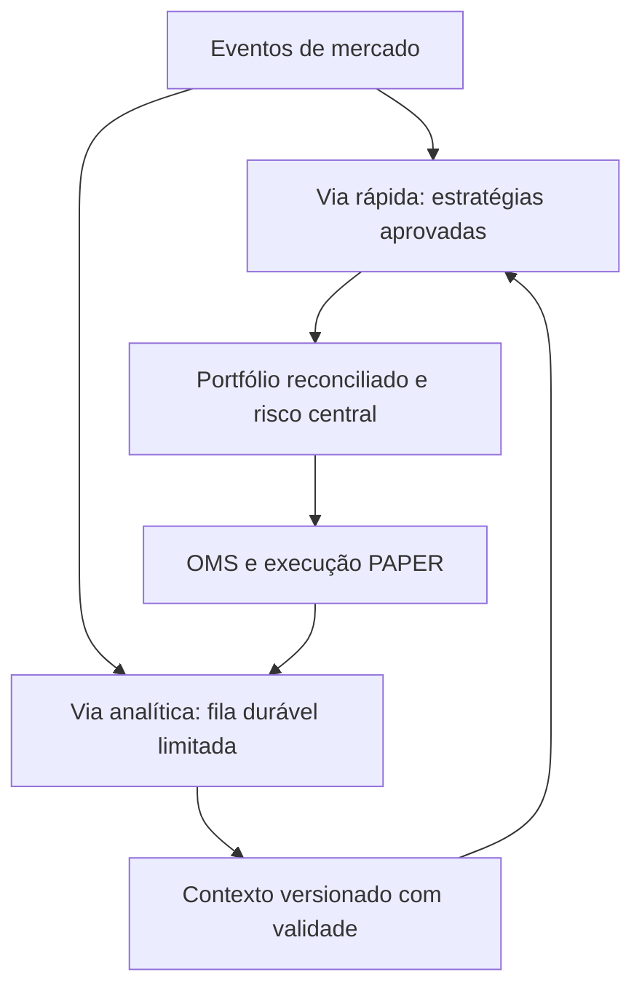

# AI Trading Office — Fase A

Esta fase entrega auditoria reproduzível e uma base de contratos. Não ativa o
escritório, não muda o ciclo de trading e não reorganiza permissões operacionais.
As fases B–F ainda precisam de implementação e validação próprias.

## Baseline e isolamento

- Projeto existente: `ernanefideles22-bot/capital-cipher-platform`.
- Branch: `feat/ai-trading-office-phase-a-20261024`.
- Baseline confirmado no Railway staging: `044839f7db879e7de4a8cf17b2b56a52eae912be`.
- Deployment de referência: `8cad61cf-be28-4a3e-ba30-574242ca5327`.
- Referência de rollback: `rollback/staging-paper-044839f-20261024`.
- Em 24/10/2026, 04:28–04:31 de Campo Grande (UTC−4), `/ready` respondeu 200
  com oito verificações positivas. `/status` confirmou PAPER, banco conectado,
  Redis/broker pronto e execução LIVE indisponível. Snapshot de saúde: 300 READY.
- Serviço recuperado usa `postgres:17-trixie`; o log do deployment ativo confirma
  PostgreSQL **17.11**. RedisEU está online. PostgresEU2 original permanece em
  manutenção, com volume preservado e sem listener. PostgresEU legado continua
  com alerta histórico, sem ser usado pelo backend ativo.
- CI do baseline: run `40061699388`, job `120776404184`, **498 passed**.
  Reexecução local do baseline: **495 passed, 3 skipped** por ausência de
  PostgreSQL/Redis descartáveis locais. Os skips não são considerados aprovações.
- A primeira execução local falhou por configuração SOCKS do ambiente de trabalho
  sem `socksio`. Repetida sem herdar proxies, mantendo o bloqueio de HTTP externo
  dos testes. Nenhuma correção no runtime foi necessária para essa diferença.

Nenhum deploy, SQL, mudança de conexão, alteração de plano, serviço ou volume é
necessário para esta fase. O inventário recebe respostas GET já salvas e não
possui credenciais de produção. Não usar URLs de banco nos argumentos do script.

## Inventário real dos 300 agentes

O comando abaixo utiliza **a composição existente** de `build_context`, com
banco desativado e sem inicializar/executar agentes. Não há uma segunda lista de
instâncias de agentes para manter em paralelo.

```bash
python backend/scripts/audit_ai_trading_office.py --output inventory-offline.json
```

Para comparar arquivos previamente obtidos pelos GETs `/api/v1/agents`,
`/api/v1/agents/status` e `/api/v1/status`:

```bash
python backend/scripts/audit_ai_trading_office.py \
  --registrations agents.json --health agents-status.json --status status.json \
  --expected-source-revision 044839f7db879e7de4a8cf17b2b56a52eae912be \
  --output inventory-observed.json
```

O auditor rejeita divergência de nomes, versões, definições, papéis ou segurança
do ambiente. Saída inclui 300 registros individuais, classe, arquivo, linha e
SHA256, função, capabilities, parâmetros de janela/threshold, dependências,
memória, fonte, latência observada e afiliação proposta. Campos sem medição são
`null`, nunca números fictícios. O manifesto inclui lógica base, indicadores,
orquestrador, consenso, estratégia, risco e OMS.

| Grupo real | Quantidade | Implementação atual |
|---|---:|---|
| PRIMARY | 3 | MarketDataAgent, QuantAgent e TrendAgent |
| Especialistas iniciais SHADOW | 12 | Indicadores e verificações OHLCV específicas |
| AdvancedOHLCVSpecialist | 25 | Fórmulas individuais, selecionadas por índice |
| Month8TechnicalSpecialist | 20 | Indicadores técnicos, incluindo proxies explícitos |
| ExternalEvidenceSpecialist | 40 | 15 derivativos, 10 macro, 10 on-chain, 5 notícias |
| Month9DiagnosticSpecialist | 50 | 8 famílias com diferentes janelas |
| Month10ResilienceSpecialist | 50 | 9 famílias com diferentes janelas |
| Month11ShadowValidationSpecialist | 100 | 10 famílias com diferentes janelas |
| Total | 300 | 21 classes concretas; 3 PRIMARY e 297 SHADOW |

Não são 300 modelos de linguagem nem 300 pesquisadores autônomos. A lógica
registrada é determinística. Há métricas e janelas reutilizadas, não 300
estratégias independentes. Confiança heurística não comprova calibração nem lucro.

### Fontes, memória, métricas e permissões

- OHLCV: `CandleStore`, alimentado pelos adaptadores públicos e pelo histórico.
  Janelas de 8/13/21/etc. são quantidade de candles, não timeframes diferentes.
- Derivativos: coletor compartilhado público Binance USD-M implementa somente
  funding, variação de open interest, basis, long/short ratio e taker flow.
  Outros dez especialistas de derivativos aguardam evidência governada.
- Macro/on-chain/notícias: consumo de `SpecialistEvidenceService`, com proveniência,
  validade e qualidade. Não foi encontrado coletor automático para essas 25
  métricas. `READY` só descreve lifecycle; evidência ausente resulta WAIT/alertas,
  não demonstra alimentação efetiva nem pesquisa de notícias.
- Memória no processo: último input/output e contadores de saúde. Memória durável:
  jobs, tentativas e entradas de input/output no Repository quando configurado.
  Não foi encontrado aprendizado autônomo a partir dessa memória.
- Avaliação já existe: forecasts/outcomes, scorecards, Brier loss, contribuição
  marginal, drift, experimentos de consenso, backtesting, walk-forward e artefatos
  versionados. Reutilizar esses serviços em vez de criar outro laboratório.
  Consultas operacionais protegidas sem credencial responderam 401; a cobertura
  real dos scorecards e experimentos não foi inferida a partir das classes.
- Saúde individual contém média e erro acumulados do processo; não é um histograma
  de P50/P95/P99 por agente/mesa. Operations possui métricas agregadas limitadas.
  Inventário conserva percentis individuais como `null` até existir amostragem.
- Snapshot dos PRIMARY: médias aproximadas 0,14 ms (MarketData), 0,45 ms (Quant),
  0,16 ms (Trend), 22 execuções cada. Isso mede análise, não fila, escrita SQL,
  ciclo completo ou latência de execução de ordens.
- `/orchestrator/status` às 04:35 de Campo Grande mediu média de ciclo
  **92.482,5 ms**, zero falhas recentes e um alerta operacional ativo. Consenso
  observado: `INSUFFICIENT_DATA`, modo `SHADOW`. A latência de ciclo não pode ser
  apresentada como submilissegundo com base nas médias dos PRIMARY.
- Agentes não recebem OMS nem RiskManager. A central produz candidato, valida risco
  e envia ao OMS. A separação é arquitetural no mesmo processo Python, não sandbox
  de capacidades/OS. O catálogo não representa uma nova barreira de segurança.
- SHADOW não origina ordem. O consenso existente pode confirmar ou apertar uma
  decisão para WAIT quando configurado em CONFIRMATION e com evidência elegível;
  não deve ser descrito como voto incondicional dos 300 agentes.
- RiskAgent, AuditAgent e PaperTradingAgent têm arquivos no repositório, mas não
  integram o registry de 300. RiskManager, AuditService e OMS são serviços centrais
  independentes: não os substituir por gestores departamentais.

## Incompatibilidades que condicionam a implementação

1. O orquestrador atual chama `execute_many` para o lote admitido e aguarda o
   término antes de consolidar. Timeouts isolam resultados, mas não removem a
   espera do lote. Escritas duráveis de 300 agentes e avaliações ficam no caminho
   crítico, mesmo com fórmulas rápidas.
2. Concorrência staging observada: semáforo runtime 64, worker 4, lote 32,
   pool PostgreSQL 4 sem overflow. Não há 300 processadores paralelos. Corrotinas
   CPU-bound que não cedem ao event loop não são interrompidas por `wait_for`;
   futuros modelos pesados exigem isolamento e orçamento específicos.
3. A fila durável tem leases, retry, backoff, idempotência e dead-letter. Não há
   prioridade departamental/fast-vs-analytics nem breaker individual completo.
   Reaproveitar fila/repositório/event journal/outbox, evitando segundo broker.
4. Backend em EU e PostgreSQL recuperado em SFO: existe travessia entre regiões.
   Não alterar regiões/serviços nesta fase. Medir ciclos, fila e SQL antes de
   prometer baixa latência ou recomendar novos recursos.
5. Configuração ativa recebe timeframe **5m**. As três estratégias GET existentes
   são SCALP_15M, DAY_1H e SWING_4H. `StrategyEngine.select` não encontra estratégia
   para 5m; decisões recentes mostram `strategy=NONE`. Isso é um bloqueio seguro,
   mas não constitui as três mesas funcionando. Ajustar ingestão/mesas apenas
   na fase C, após testes e aprovação de deploy. Não inventar estratégia 5m.
6. Os quantitativos pedidos não correspondem às funções existentes. A projeção
   abaixo é uma afiliação sem alterar agentes ou papéis. Um diagnóstico de volume
   não vira pesquisador macro apenas para preencher vagas.
7. Alternar estratégia pela API atual atua no StrategyEngine em memória e grava
   auditoria. A governança futura precisa tratar persistência/versionamento e
   promoção explicitamente, sem presumir que uma alteração se mantém após restart.

## Projeção organizacional conservadora

Todos os 300 são inventariados uma vez; gestores e diretoria são papéis lógicos
de desenho, não novos agentes. Quantidades de afiliação não são contratações,
agentes em execução ou evidência de capacidade institucional completa.

| Departamento | Afiliação sugerida pela lógica atual | Meta solicitada |
|---|---:|---:|
| Inteligência de mercado | 30 | 40 |
| Análise técnica avançada | 45 | 40 |
| Pesquisa quantitativa | 32 | 35 |
| Estratégias de trading | 2 | 35 |
| Microestrutura e execução | 8 | 30 |
| Inteligência cripto | 25 | 25 |
| Macroeconomia e notícias | 15 | 20 |
| Gestão de portfólio | 13 | 25 |
| Risco e segurança | 30 | 25 |
| Aprendizado e auditoria | 100 | 25 |
| Total | 300 | 300 |

Cada departamento tem definição executável de responsabilidade, KPI proposto,
manager lógico e contrato. O manager poderá apenas ler contexto, publicar análise
ou propor experimento. Os KPIs são definições, sem valores operacionais inventados.
A diretoria futura agenda/reprioriza trabalho e seleciona versões já aprovadas;
não aprova risco, não ignora o OMS e não depende de humano/voto geral por ordem.
Green Coff fica reservado, desabilitado e sem regras inventadas.

## Arquitetura incremental para B–F



**Via rápida:** candle fechado + identificação da mesa → dedup de evento/sinal →
estratégias aprovadas → contexto recente opcional → estado reconciliado de
portfólio → risco central obrigatório → OMS PAPER → journal e resultados.
Não espera LLM, gestores, pesquisa ou os 297 SHADOW. Contexto ausente/expirado
não autoriza relaxar risco. Banco, broker obrigatório, posições, mercado ou risco
indisponíveis bloqueiam novas ordens. Validade do sinal é revalidada no envio,
não somente na criação do candidato.

**Via analítica:** usar AgentRuntime e fila já existentes, com prioridades justas,
limites por departamento, deadlines totais, breaker/recuperação, cancelamento e
backpressure. Publicar contexto `OfficeAnalysis` ligado à versão/hash do agente e
evidências persistidas. Estado válido é `[published_at, expires_at)`, com idade
limitada desde `as_of`, evitando renovar evidência antiga quando uma tarefa atrasa.
Contrato não concede aprovação de risco, envio de ordem ou promoção de versão.

**Mesas:** reutilizar StrategyEngine e OMS compartilhados; chaves idempotentes
incluem versão da estratégia, mesa, ativo e candle. Centralizar reserva de exposição
e conflito de posições em transação/lock por portfólio/ativo, não em memória de
cada mesa. Registrar evento/fila/decisão/risco/envio/fill para P50/P95/P99 e custo.

**Análise técnica:** reutilizar indicators, especialistas de suporte/resistência,
estrutura e regime. Adicionar módulos ausentes (Fibonacci, linhas/canais, pivôs
confirmados e falsos rompimentos) com fixtures sem look-ahead, timeframes 15m/1h/4h
e evidência/invalidade explícitas. Padrão gráfico isolado não prova rentabilidade.

**Memória e aprendizado:** reutilizar tabelas append-only, forecasts/outcomes,
scorecards, drift e walk-forward. Experimentos SHADOW geram propostas; promoção
exige versão, critérios pré-registrados, fora-da-amostra, revisão e rollback.
Não permitir autoedição da estratégia operacional por agente ou manager.

**Dashboard:** adicionar AI Trading Office à identidade atual. Consumir snapshot
real de registry, jobs, contexto, decisões, OMS, alertas e resultados. Separar
`registered`, `enabled`, `RUNNING`, `READY/idle`, falhas e cobertura de dados.
Percentis e retorno sem amostra aparecem indisponíveis, não zero de conveniência.

**Carteiras A/B/C/D:** iniciar em laboratório isolado com mesmos datasets,
calendário, custos, capital e critérios, sem duplicar saldo/ordens do staging.
A=benchmark simples versionado; B=baseline 044839f; C=office aprovado; D=experimentos.
Usar backtests e walk-forward purgados, holdout intocado, semente/dataset/hash,
Sharpe com frequência definida, drawdown, profit factor/expectativa e intervalos
de incerteza. Sem amostra suficiente, sem declaração de superioridade financeira.

## Critérios e próximos commits

- **A:** 300 identidades comparadas ao staging, proveniência, lacunas, arquitetura,
  contratos executáveis testados e baseline/rollback preservados.
- **B:** isolamento real do caminho crítico; prioridade/justiça, deadline,
  breaker e testes de 300 jobs, agente lento, lease, duplicação e replay.
- **C:** três mesas e OHLCV multi-timeframe; testes simultâneos de reserva de
  exposição/conflito; risco, sinais vencidos e execução tardia sempre bloqueados.
- **D:** memória/avaliação reaproveitadas, experimentos fora-da-amostra,
  promoção explícita e rollback reproduzível após reinicialização.
- **E:** interface com dados reais e teste browser → API → persistência.
- **F:** suite anterior integral, cenários de falha PostgreSQL/Redis,
  restauração/rollback descartáveis, quatro carteiras e relatório estatístico.

Testar uma fase antes de afirmá-la concluída. Antes de qualquer publicação,
apresentar commit exato, migrações/configurações, resultado do CI e impacto para
aprovação explícita. Nesta fase não há migração nem mudança em serviço ativo;
reversão do código consiste em voltar à referência, sem restaurar/apagar dados.
